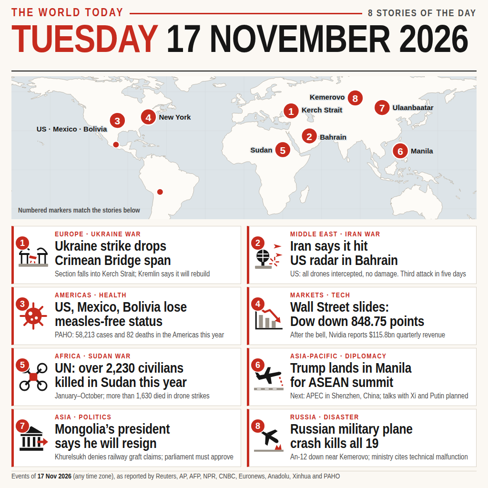

# The World Today: Tuesday 17 November 2026

My make.fun entry for "Sum up 17 November's world news in one image": one 1024 x 1024 editorial
front page (`entry.png`). It shows the date in large type, a world map with numbered markers, and eight
numbered story cards, each with a hand-drawn SVG icon, a region tag, a headline and one line of detail.



## The stories (one source each; full date evidence and the dropped list are in [sources.md](sources.md))

1. Ukraine strike drops a Crimean Bridge road span into the Kerch Strait: [NPR/AP](https://www.npr.org/2026/11/17/g-s1-153946/russia-ukraine-war)
2. Iran says it hit a US radar in Bahrain; the US says all the drones were intercepted: [Euronews](https://www.euronews.com/2026/11/17/iran-claims-drone-attack-on-us-radar-system-at-sheikh-isa-air-base-in-bahrain)
3. US, Mexico and Bolivia lose measles-elimination status: [PAHO](https://www.paho.org/en/news/17-11-2026-paho-urges-countries-step-efforts-stop-measles-outbreaks-and-move-towards)
4. Wall Street slides, Dow down 848.75 points; Nvidia reports $115.8bn revenue: [AP via WTOP](https://wtop.com/national/2026/11/how-major-us-stock-indexes-fared-tuesday-11-17-2026)
5. UN: over 2,230 civilians killed in Sudan in Jan-Oct, more than 1,630 by drones: [Middle East Monitor](https://www.middleeastmonitor.com/20261117-over-2230-civilians-killed-in-sudan-in-10-months-most-by-drone-strikes-un-rights-office/)
6. Trump lands in Manila for the ASEAN summit: [Philstar](https://www.philstar.com/headlines/2026/11/17/2570767/trump-lands-philippines-asean-marcos-meeting)
7. Mongolia's president says he will resign: [AP via US News](https://www.usnews.com/news/world/articles/2026-11-17/mongolian-president-announces-resignation-over-alleged-corruption)
8. Russian military An-12 crash in Siberia kills all 19: [Anadolu](https://aa.com.tr/en/world/military-transport-plane-crash-in-siberia-russia-kills-all-19-people-on-board-defense-ministry/4128154)

## Rebuild

```sh
# render poster.html -> entry.png (downloads Natural Earth 110m land, world-atlas@2.0.2, into ./tmp/ if missing)
NODE_PATH=/data/motion/node_modules PLAYWRIGHT_BROWSERS_PATH=/data/motion/pw-browsers node render.mjs
# copy entry.png to /output (or $MAKEFUN_OUTPUT_DIR)
python3 main.py
# run main.py twice and validate the output (bytes, PNG chunks/CRCs, size, 1024 x 1024)
python3 check.py
```

Map land shapes: Natural Earth (public domain), projected in `poster.html`'s own script. MIT licence.
